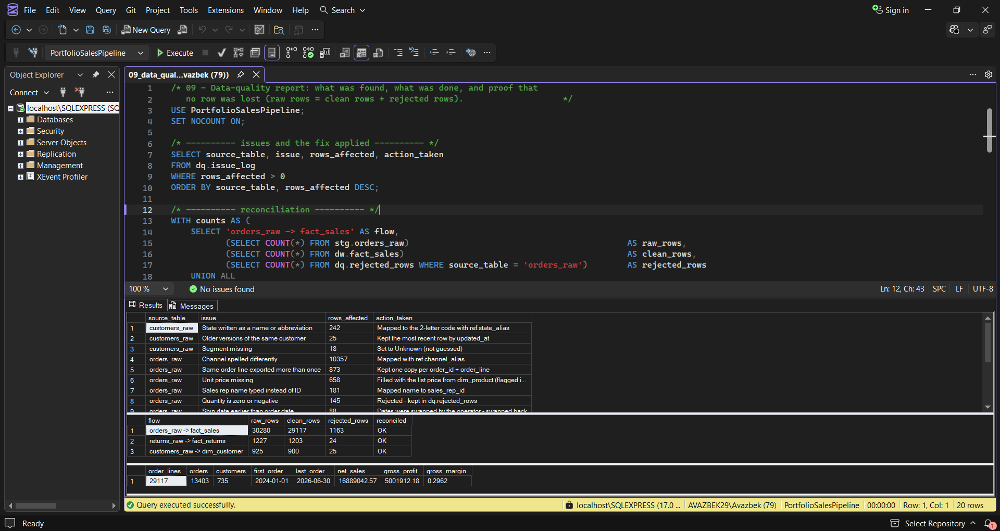
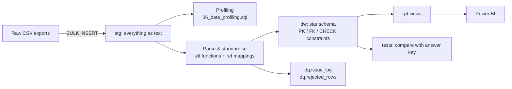
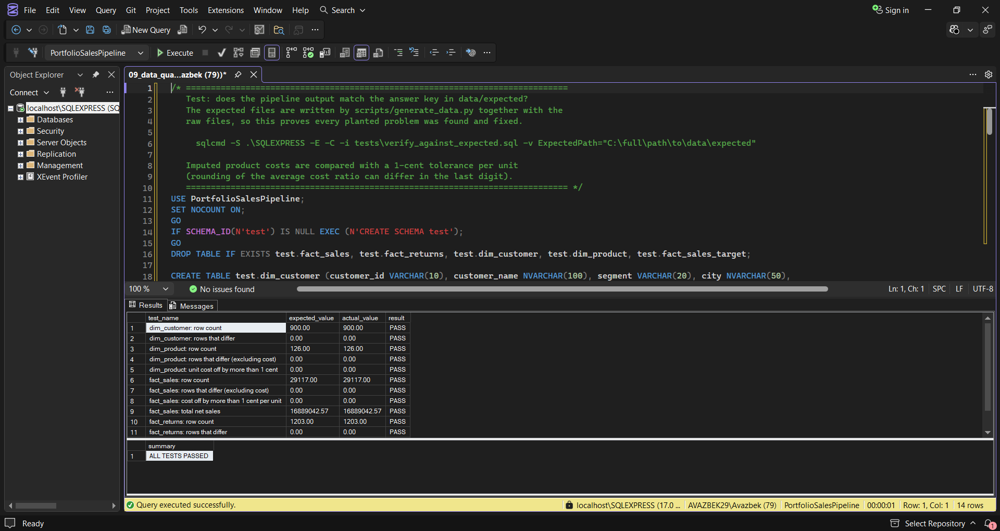

# SQL Data Cleaning Pipeline: Raw Sales Exports → Star Schema (SQL Server)

A re-runnable T-SQL pipeline that takes four messy CSV exports from an e-commerce/ERP system and turns them into a clean, tested star schema. The result feeds the [Sales & Profitability Dashboard](https://github.com/avazbeksalimov2229-dev/sales-performance-dashboard) in Power BI.

**Every problem is measured, fixed or rejected with a reason, and logged.** No row disappears silently.

> **Data:** synthetic (a fictional company, "Harbor & Pine Supply Co."). [`scripts/generate_data.py`](scripts/generate_data.py) writes the raw files with **1,100+ planted data problems**, plus an answer key (`data/expected/`) that the automated test compares against.

---

## Result

| Flow | Raw rows | Clean rows | Rejected (with reason) | Reconciled |
|---|---:|---:|---:|:---:|
| orders → `fact_sales` | 30,280 | 29,117 | 1,163 | ✅ |
| returns → `fact_returns` | 1,227 | 1,203 | 24 | ✅ |
| customers → `dim_customer` | 925 | 900 | 25 (older versions) | ✅ |



**Automated test: 13 / 13 checks passed.** The output matches the answer key row by row, and total net sales match to the cent ($16,889,042.57).
The full pipeline runs in about 4 seconds on SQL Server Express.

## What was wrong with the data, and what the pipeline does

| Source | Problem found by profiling | Rows | Fix |
|---|---|---:|---|
| orders | Same order line exported twice (649 exact copies, the rest re-formatted) | 873 | De-duplicated on the business key `order_id + order_line` **after** normalising; also checks that the copies agree |
| orders | Order date in 4 formats (`2025-03-14`, `03/14/2025`, `2025-03-14 10:22:05`, `Mar 14, 2025`) | 10,648 | `etl.fn_parse_date` (language-independent) |
| orders | Channel written 12 different ways (`Web`, `E-commerce`, `B2B`, `Store`, `ONLINE`…) | 10,357 | `ref.channel_alias` mapping table |
| orders | Discount as `15%` instead of `0.15` | 7,823 | `etl.fn_parse_discount` |
| orders | Customer ID with spaces or lower case | 2,676 | `UPPER(TRIM())` |
| orders | Quantity stored as text (`12 units`, padded) | 1,815 | `etl.fn_parse_int` |
| orders | Unit price as currency text (`$1,299.00`) | 1,485 | `etl.fn_parse_money` |
| orders | Unit price missing | 670 | Filled from the product list price, flagged `is_price_imputed` |
| orders | Sales rep **name** typed instead of rep ID | 187 | Mapped through `dim_sales_rep` |
| orders | Ship date before order date (fields swapped) | 89 | Swapped back, flagged `is_dates_swapped` |
| orders | Quantity zero or negative | 145 | **Rejected** |
| orders | SKU not in the product master | 87 | **Rejected** |
| orders | Test orders from the web team | 58 | **Rejected** |
| customers | State as name / abbreviation (`Calif.`, `N.Y.`, ` ca`) | 232 | `ref.state_alias` → 2-letter code + region |
| customers | Same customer twice (older address) | 25 | Kept the latest row by `updated_at` (`ROW_NUMBER`) |
| customers | Segment missing | 18 | `Unknown` (not guessed) |
| products | Category spelled differently (`Tech`, `Home&Decor`…) | 59 | `ref.category_alias` |
| products | Unit cost missing | 3 | Imputed: list price × the subcategory's average cost ratio, flagged |
| returns | Reason written 14 different ways (`damaged`, `Faulty`, `no longer needed`…) | 771 | `ref.return_reason_alias` |
| returns | Return for an order line that does not exist | 12 | **Rejected** |
| returns | More units returned than sold | 12 | **Rejected** |

Every row in this table comes from `dq.issue_log`. Rejected rows are kept, with their original values, in `dq.rejected_rows`.

## Pipeline



| Script | What it does |
|---|---|
| `00_run_all.sql` | Runs everything in order (sqlcmd mode) |
| `01_create_database.sql` | Database + schemas `stg`, `ref`, `etl`, `dw`, `dq` |
| `02_create_staging_and_dq.sql` | Text-only staging tables, data-quality log tables |
| `03_load_raw_files.sql` | `BULK INSERT` with `FORMAT = 'CSV'` (handles quoted fields) |
| `04_reference_data.sql` | Mapping tables for states, channels, categories, return reasons |
| `05_helper_functions.sql` | Safe parsers for dates, money, discounts and integers (return NULL, never fail) |
| `06_data_profiling.sql` | Measures every issue **before** fixing anything |
| `07_build_dimensions.sql` | `dim_date`, `dim_customer`, `dim_product`, `dim_sales_rep` |
| `08_build_facts.sql` | `fact_sales`, `fact_returns`, `fact_sales_target`, rejects and fixes |
| `09_data_quality_report.sql` | Issue log, reconciliation (raw = clean + rejected), headline numbers |
| `10_powerbi_views.sql` | `rpt` views: the only thing Power BI reads |
| `11_analysis_queries.sql` | 10 business questions (below) |
| `tests/verify_against_expected.sql` | Row-by-row comparison with the answer key |



## Business questions answered in SQL (`11_analysis_queries.sql`)

| # | Question | Technique | Finding |
|---|---|---|---|
| Q1 | How are sales trending? | `LAG(…,12)`, running `SUM() OVER` | 2025 +18.4% vs 2024; H1 2026 slowed to +7.0% |
| Q2 | Which regions hit target? | CTE + join to monthly targets | Central and East missed target in 3 of 4 quarters of 2025 |
| Q3 | How many products make 80% of sales? | cumulative window sum (Pareto) | 44 of 126 products (35%) |
| Q4 | Top products by gross profit | `TOP` + `GROUP BY` | top 2 products = 20% of total gross profit |
| Q5 | Do discounts destroy margin? | `CROSS APPLY` banding | Furniture margin 36% without discount, 6% above 20% |
| Q6 | Do new customers come back? | monthly cohorts, `DATEDIFF(MONTH)` | retention by cohort at 3 / 6 / 12 months |
| Q7 | Who are the best customers? | RFM with `NTILE(5)` | 145 "Champions" = 56% of sales; 138 "At risk" customers (avg. 259 days since last order) = win-back list |
| Q8 | What comes back and why? | `ROW_NUMBER` for the top reason | Monitors 8.7% return rate, 56% "damaged in transit" |
| Q9 | Sales team ranking | `RANK() OVER (PARTITION BY region)` | rep share within region by year |
| Q10 | Channel mix and AOV | share of total with `SUM(SUM()) OVER` | Wholesale = 70% of sales, AOV ≈ $7.7k |

## How to run

Requirements: SQL Server 2017 or later (Express is enough), `sqlcmd`, and Python 3.9+ (only to regenerate the data).

```bat
cd sql
sqlcmd -S .\SQLEXPRESS -E -C -b -i 00_run_all.sql -v DataPath="C:\path\to\03-sql-sales-data-pipeline\data\raw"
sqlcmd -S .\SQLEXPRESS -E -C -i ..\tests\verify_against_expected.sql -v ExpectedPath="C:\path\to\03-sql-sales-data-pipeline\data\expected"
```

`BULK INSERT` reads the files as the SQL Server service account, so that account needs read access to the folder.
The scripts are idempotent: run them again and you get the same result.

## Repository

```
data/raw/        messy exports (input)
data/expected/   answer key for the test
scripts/         generate_data.py
sql/             00 – 11 pipeline and analysis scripts
tests/           verify_against_expected.sql
screenshots/     SSMS screenshots
```

---
Built by Avazbek S. as a portfolio project. SQL Server · T-SQL · Data Cleaning · ETL · Data Quality · Data Modeling
